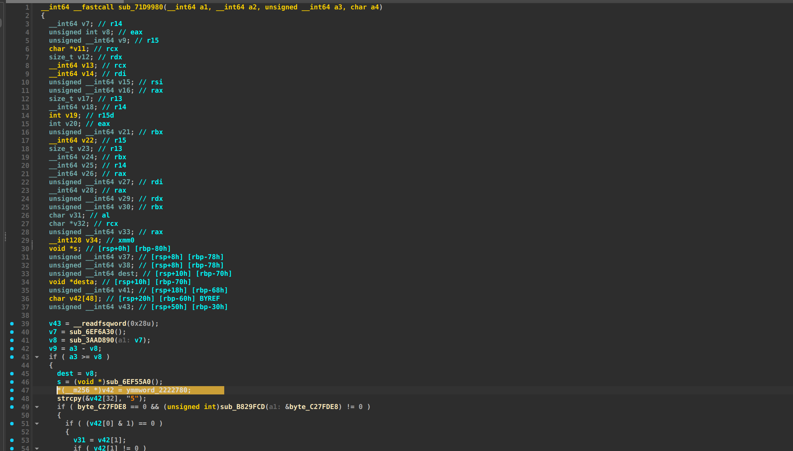

# QQ ASAR 解密工具

这个项目用于解密 QQ ASAR 文件中的加密内容。QQ 会在 ASAR 内部文件上使用特定加密方式；如果你已经从 QQ 原始安装包中提取出原版 ASAR 目录，可以使用本脚本将其中的文件逐个解密并输出到新目录。

## 项目说明

脚本会递归处理输入目录中的所有普通文件，并按相对路径写入输出目录。它会尝试对每个文件执行 AES-CBC 解密，并在解密失败时输出失败信息。

## 环境要求

- Python 3
- 依赖：`cryptography`

安装依赖：

```bash
python3 -m pip install -r requirements.txt
```

## 使用方法

```bash
python3 decrypt_qq_asar.py <input> <output> <constant>
```

参数说明：

- `input`：已提取的 ASAR 文件目录
- `output`：解密后输出目录
- `constant`：从 QQ 二进制中提取的 33 字节十六进制常量

示例：

```bash
python3 decrypt_qq_asar.py ./asar_extracted ./asar_decrypted 0051C42C0C8D2C929CEBFECA3B0492F7157739C7401D45545D2BDD4A15458CF735
```

说明：

- 脚本会校验输入目录是否存在，并拒绝输入/输出为同一路径或互相包含。
- 输出目录不存在时会自动创建；如果输出目录已存在但不是目录，则会报错。
- 仅处理普通文件，符号链接会被跳过。

## 常量 / 密钥获取方式

`constant` 需要从 QQ 可执行文件或其对应二进制中提取。常见做法是使用 IDA 或其他反汇编工具打开 QQ 二进制，定位解密函数。

Linux x64 QQ 的定位方式：

1. 打开 `/opt/QQ/qq`
2. 使用 IDA 中的 `Alt + B` 搜索以下特征码：

```text
55 48 89 E5 41 57 41 56 41 55 41 54 53 48 83 EC 58 89 4D 88 49 89 D5 48 89 F3 49 89 FC 64 48 8B 04 25 28 00 00 00 48 89 45 D0 E8 ?? ?? ?? ?? 49 89 C6 48 89 C7 E8 ?? ?? ?? ?? 89 C0 4D 89 EF 49 29 C7 73 ??
```

3. 目标函数附近通常可找到包含加密常量的值，例如 `ymmword_2222780` 等字段，这些数据会构成你需要传入的十六进制常量。


4. 脚本内部会校验该字符串必须是 33 字节的十六进制值，并对前 1 字节之外的内容按 `byte ^ 0x7B` 处理后得到 32 字节 AES key。

## 注意事项

- 该脚本适用于“已提取原版 ASAR 目录”的文件解密，不负责下载、打包或重构 ASAR。
- 如果你的 QQ 版本或二进制结构发生变化，解密常量的位置可能需要重新定位。
- 仅在拥有合法使用授权的前提下使用本工具。